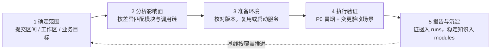

# commit-test

<p align="center">
  <a href="README_EN.md">English</a> | <a href="README.md">中文</a>
</p>

<p align="center">
  <a href="LICENSE"></a>
  
  
</p>

基于 git 提交或工作区改动的选择性集成验证：分析影响面，准备环境，通过真实页面验证变更行为，分别保存模块知识与本次证据。P0 冒烟和变更验收分开记录，未覆盖的必要场景不会因已有提交基线而被跳过。

## 使用方式

用「测一下最近的提交/改动」「跑集成测试」「验证这批提交/这次改动」「回归验证」等说法触发。不用于单元测试编写或纯代码审查。需要支持 skills 的宿主（ZCode / Codex / OpenCode）与可用的浏览器工具。

## 工作原理



| 阶段 | 做什么 | 细节 |
|------|--------|------|
| 1 确定范围 | 采用用户明确的提交/工作区/目标；P0 冒烟与变更验收分开列出 | [analysis.md](phases/analysis.md) |
| 2 分析影响面 | 按各仓库最终差异匹配模块，未命中时追踪服务、API 与页面入口 | [analysis.md](phases/analysis.md) |
| 3 准备环境 | 核对环境与待测版本，优先复用已运行的匹配服务 | [env.md](phases/env.md) |
| 4 执行验证 | 真实页面场景 + 与验收目标对应的证据（截图、请求、数据核对） | [execute.md](phases/execute.md) |
| 5 报告与沉淀 | 本次证据写入 run，已核实的稳定知识才更新模块 | [execute.md](phases/execute.md) |

## 设计原则

- **知识与证据分开**：模块中的步骤和历史结果不代表本次通过，每次运行独立记录。
- **基线按覆盖推进**：相同 HEAD 的 P0 通过不能跳过尚未执行的变更验收；有未覆盖就不宣称整批完成。
- **真实页面证据**：构建、API 检查、只读数据库查询可补充证据，不能冒充已走过真实页面。
- **如实记录**：失败、受阻、降级与未执行均说明；证据缺失标注未留存，不补造。

## 结构

```
SKILL.md          主干：流程、能力与授权边界（渐进加载）
phases/           细节：analysis（范围与影响）/ env（环境）/ execute（浏览器执行）
TEMPLATE.md       模块知识文件模板
LICENSE           MIT
projects/         本地积累区（git 忽略，不同步）
  └── <项目名>/
      ├── env.md             关联仓库、启动命令、地址、账号来源与环境限制
      ├── tested-commits.md  按 scope/depth/场景覆盖记录各仓库版本与相关 dirty
      ├── modules/*.md       稳定知识：触发范围、调用链、入口、场景与判断依据
      └── runs/*.md          每次验证的实际操作、结果、证据与未覆盖项
```

## 安装

本仓库为技能源目录，克隆后链接到宿主 skills 目录：

| 宿主 | skills 目录 |
|------|-------------|
| ZCode | `~/.zcode/skills/` |
| Codex | `~/.codex/skills/` |
| OpenCode | `~/.config/opencode/skills/` |

```bash
git clone https://github.com/ThinkDonk/commit-test.git
# Windows（junction）
mklink /J "%USERPROFILE%\.zcode\skills\commit-test" <克隆路径>\commit-test
# macOS / Linux（symlink）
ln -s "$PWD/commit-test" ~/.zcode/skills/commit-test
```

首次运行会在 `projects/` 下按项目现场初始化知识目录（env、模块、基线与运行记录）。

## 同步语义

- **进 git**：SKILL.md、phases/、TEMPLATE.md 及两个 README（方法论，跨机器同步）
- **不进 git**：`projects/`（本机环境、基线、模块知识与运行证据；`.gitignore` 已排除）。忽略目录不等于凭据库，报告不复制密码/令牌。

浏览器采用当前宿主实际可用的工具，不强制依赖特定辅助技能。详细执行、结果证据与基线更新规则见 [SKILL.md](SKILL.md) 及其阶段文档。

问题与建议欢迎提 Issue。
