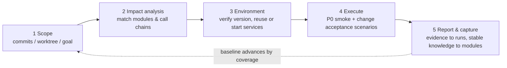

# commit-test

<p align="center">
  <a href="README_EN.md">English</a> | <a href="README.md">中文</a>
</p>

<p align="center">
  <a href="LICENSE"></a>
  
  
</p>

Selective integration verification driven by git commits or working-tree changes: analyze the impact surface, prepare the environment, verify changed behavior through real pages, and record reusable module knowledge and per-run evidence separately. P0 smoke checks and change acceptance are tracked independently, so necessary scenarios are never skipped just because a commit baseline already exists.

## Usage

Trigger it with requests like "test the recent commits/changes", "run integration tests", "verify this batch of commits / this change", or "regression check". It is not for writing unit tests or pure code review. Requires a host that supports skills (ZCode / Codex / OpenCode) and an available browser tool.

## How it works



| Phase | What happens | Details |
|-------|--------------|---------|
| 1 Scope | Use the commits/worktree/goal the user stated; list P0 smoke and change acceptance separately | [analysis.md](phases/analysis.md) |
| 2 Impact analysis | Match modules by each repo's final diff; trace services, APIs, and page entries on a miss | [analysis.md](phases/analysis.md) |
| 3 Environment | Verify environment and target version; prefer reusing already-running matching services | [env.md](phases/env.md) |
| 4 Execute | Real-page scenarios plus evidence matching the acceptance goal (screenshots, requests, data checks) | [execute.md](phases/execute.md) |
| 5 Report & capture | Run evidence goes to runs/; only verified stable knowledge updates modules/ | [execute.md](phases/execute.md) |

## Design principles

- **Knowledge and evidence stay separate**: steps and past results in modules do not prove this run; every run is recorded independently.
- **Baselines advance by coverage**: a P0 pass at the same HEAD cannot skip pending change-acceptance scenarios; anything uncovered means the batch is not accepted.
- **Real-page evidence**: builds, API checks, and read-only database queries can supplement evidence but never stand in for having walked the real page.
- **Honest records**: failures, blocks, degradations, and skipped steps are all stated; missing evidence is marked as not retained, never fabricated.

## Structure

```
SKILL.md          Entry point: workflow, capabilities, and authorization boundaries (progressive loading)
phases/           Details: analysis (scope & impact) / env (environment) / execute (browser execution)
TEMPLATE.md       Template for module knowledge files
LICENSE           MIT
projects/         Local accumulation area (git-ignored, not synced)
  └── <project>/
      ├── env.md             Linked repos, start commands, addresses, credential sources, and environment limits
      ├── tested-commits.md  Per-repo versions with scope/depth/scenario coverage and relevant dirty state
      ├── modules/*.md       Stable knowledge: trigger scope, call chains, entries, scenarios, and evidence criteria
      └── runs/*.md          Actual operations, results, evidence, and uncovered items for each run
```

## Installation

This repository is the skill source directory. Clone it and link it into your host's skills directory:

| Host | Skills directory |
|------|------------------|
| ZCode | `~/.zcode/skills/` |
| Codex | `~/.codex/skills/` |
| OpenCode | `~/.config/opencode/skills/` |

```bash
git clone https://github.com/ThinkDonk/commit-test.git
# Windows (junction)
mklink /J "%USERPROFILE%\.zcode\skills\commit-test" <clone-path>\commit-test
# macOS / Linux (symlink)
ln -s "$PWD/commit-test" ~/.zcode/skills/commit-test
```

On the first run, the knowledge directory for a project is initialized on the spot under `projects/` (env, modules, baselines, and run records).

## Sync semantics

- **In git**: SKILL.md, phases/, TEMPLATE.md, and both READMEs (methodology, synced across machines)
- **Not in git**: `projects/` (local environment, baselines, module knowledge, and run evidence; excluded by `.gitignore`). An ignored directory is not a credential store — reports never copy passwords or tokens.

The browser layer uses whatever tooling the current host actually provides; no specific auxiliary skill is required. Detailed execution rules, result evidence, and baseline updates are documented in [SKILL.md](SKILL.md) and its phase files.

Issues and suggestions are welcome.
